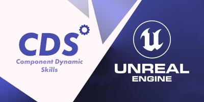
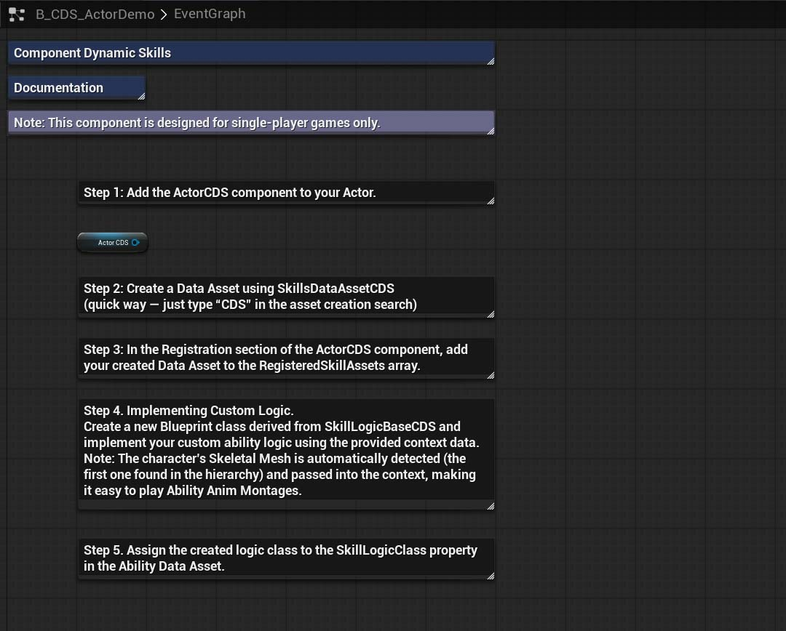
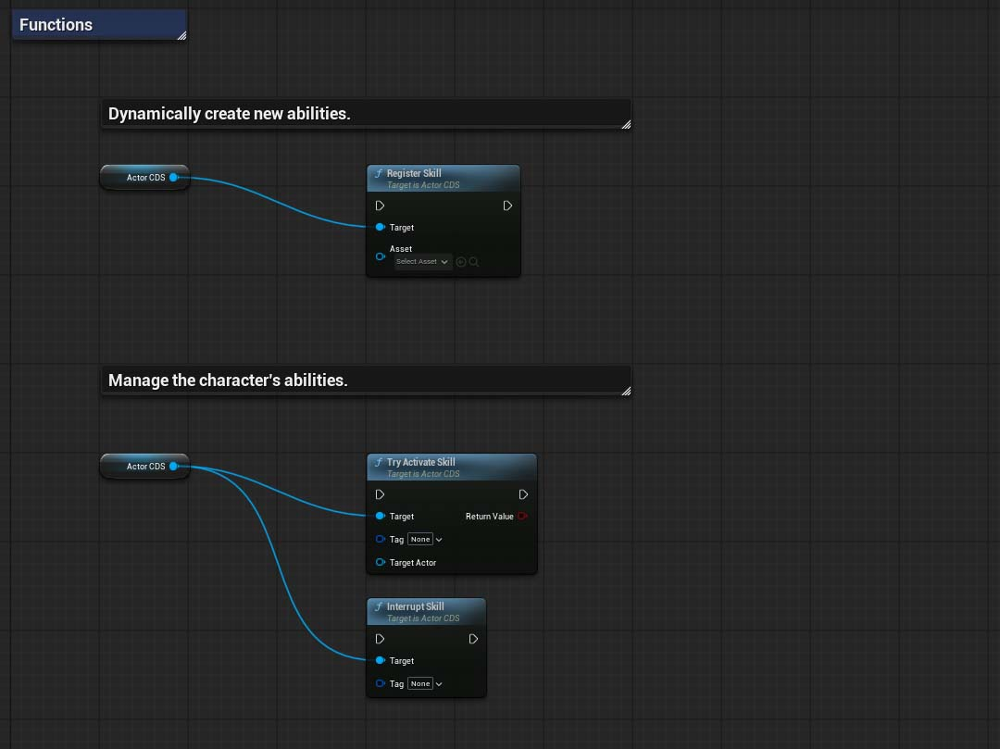
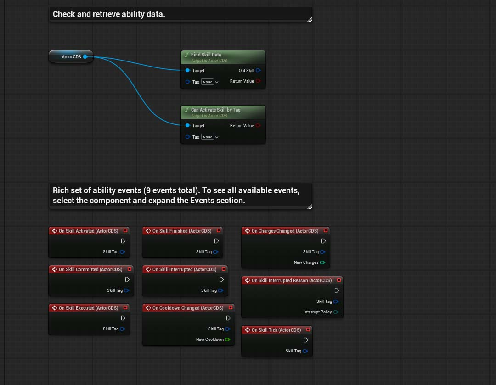
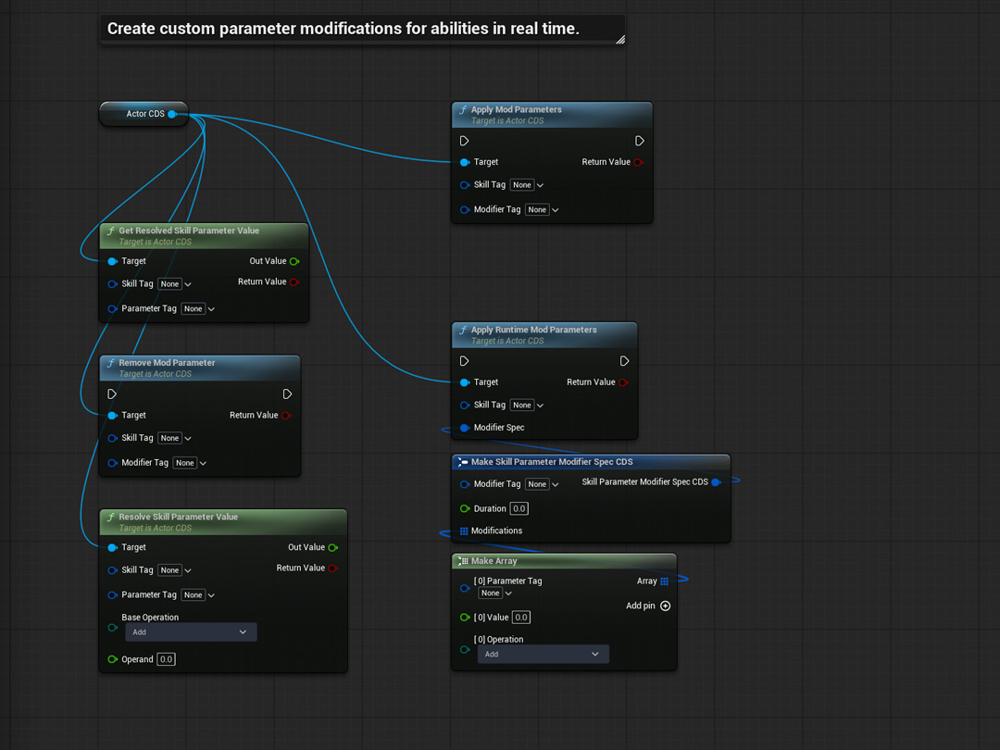

# Component Dynamic Skills
Unreal Engine 5 Actor Component for managing dynamic abilities in single-player games. This is a greatly simplified version of Unreal Engine’s Gameplay Ability System (GAS), designed to make creating single-player games much easier and more accessible.

 

> [!NOTE]
> The plugin has been pre-packaged only for Win64 and Android.

## Latest Updates
`Experimental`

`Version 1.2.0`
- Built for Unreal Engine 5.8.3.
- Added a modifier system for tweaking numeric ability parameters. Several modification types are supported:
    - Preset-based adjustments using predefined settings.
    - Dynamic adjustments for calculating complex formulas right before parameter changes.
    - One-time runtime parameter modifications without state persistence.
- Added the `ResolvedParameters` context parameter to the `SkillLogicBaseCDS` class, allowing access to custom modifier data directly within the encapsulated logic.
- The parameter modification system now includes a built-in timer. For example, you can buff selected ability stats for a specific duration simply by specifying the duration in seconds directly within the modifier settings.
- In `SkillsDataAssetCDS`, the `ExecutionType` element option has been renamed from `Melee` to `Instant`.
- Added the `bCanStart` input parameter to the `TryActivateSkill` function.
- Added a forced ability interruption function to `SkillLogicBaseCDS`.

## What it's for
- Management and configuration of player character abilities, featuring the ability to pass data into the State Tree.

## Features
- Support for dynamic creation of abilities.
- Create, group, and blend ability setting contexts with subsequent integration into the State Tree.
- Encapsulated logic with rich context data.
- Quick search by typing "CDS" — easily find all related classes and functions. No need to remember long function names — simply type “CDS” in the search box and start creating!
- Automatic detection of the character’s Skeletal Mesh for the encapsulated ability logic context.
This is especially useful when you need to play Anim Montages inside the ability logic.
- Integrated ability handling into the State Tree via the `StateTreeTaskExecuteSkillCDS` task, allowing centralized configuration of AI behavior (such as HP retreat thresholds and pre-skill movement checks) and balance management for multiple NPC classes via `SkillsDataAssetCDS` and `ContextBindings`.

## Install

> [!NOTE]
> Starting with Unreal Engine version 5.6, it is recommended to use the new project type based on C++. After copying the plugin folder, be sure to perform a full project rebuild in your C++ IDE.

1. Make sure the Unreal Engine editor is closed.
2. Move the "Plugins" folder to the root folder of your created project.
3. Rebuild the project in your C++ IDE.
4. Done! The 'Component Dynamic Skills' folders should appear in the Unreal Engine browser and the plugin should be automatically activated. If the plugin folder is not visible, activate visibility through the browser settings: `Settings > Show Plugin Content`.

## How to use it?
An interactive step-by-step tutorial on how to use CDS can be found in the file: `B_CDS_ActorDemo`, which is located at the path `Plugins\ComponentDynamicSkills\`.

## (C++) Documentaion
All sources contain self-documenting code.
